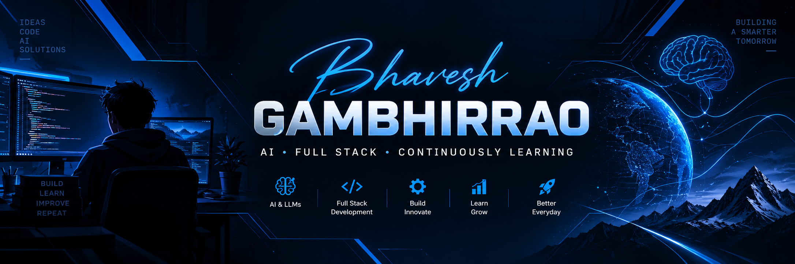

  

# Hey, I'm Bhavesh 👋

### 💙 AI + Full-Stack Developer

Building, learning, and exploring the world of technology.

I enjoy working with **Artificial Intelligence, web development, and software engineering** to turn ideas into practical solutions.

- 🤖 Exploring AI, LLMs, and RAG systems
- 🌐 Interested in full-stack web development
- 💻 Working with Python, JavaScript, and modern development tools
- 📚 Always learning something new
- 🎯 Focused on becoming a better developer every day

---

## ⚡ Tech Stack

**Languages**

**Frontend & Backend**

**AI, Databases & Tools**

---

## 📊 GitHub Stats

---

## 🌐 Connect With Me

💼 **LinkedIn:** [Connect with me](https://www.linkedin.com/in/bhavesh-gambhirrao-2aab44352/)

🐙 **GitHub:** [Bhavesh0756](https://github.com/Bhavesh0756)

---

## 💭 Developer Mindset

*Build. Learn. Improve. Repeat.* 🚀
